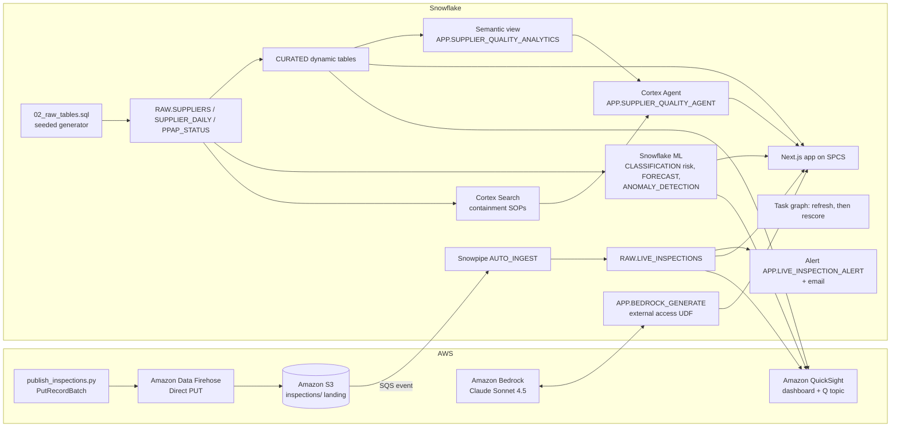

# Thailand Automotive Supplier Quality

Incoming-inspection quality analytics for **40 fictional automotive parts suppliers across 8 Thai cities** (Rayong, Chon Buri, Chachoengsao, Ayutthaya, Samut Prakan, Pathum Thani, Prachin Buri and Nakhon Ratchasima) and 5 part categories: fasteners, stampings, wire harnesses, plastic mouldings and brake components. Every inspection lot a supplier delivers to a fictional vehicle assembly plant is either accepted at incoming inspection or it is not. Built on Snowflake, optionally with AWS, the demo turns those lots into first-pass acceptance KPIs, a 7-day non-conformance risk score per supplier, an inspection alert email and an AI action memo for the head of supplier quality. Exception checks are demo signals on synthetic data, not supplier audit, PPAP or certification verdicts.

## Architecture

A supplier quality pipeline built on **Snowflake** (Dynamic Tables, Snowflake ML, Cortex Search, Cortex Agent, Cortex AI_COMPLETE, SPCS) and, in the full build, **AWS** (Amazon Data Firehose, Amazon S3, Bedrock Claude, QuickSight + Amazon Q). Inspection lot results land in `RAW.LIVE_INSPECTIONS`. Dynamic tables curate 90 days of supplier-day history: inspection lots and parts inspected, parts accepted at first pass, quality exception flags, confirmed non-conformances, lots quarantined at receiving, supplier quality reviews and PPAP approval coverage. Snowflake ML scores 7-day non-conformance risk per supplier, forecasts network-wide inspection lots and flags dimensional deviation anomalies. A Cortex Agent answers questions with SOP citations, and an LLM drafts the action memo.

Interactive diagrams (hover for object names): [Snowflake only](docs/architecture-snowflake.html) | [AWS + Snowflake](docs/architecture-aws.html). The app shows both on its Architecture & Data tab, the current build first. Regenerate them with `python3 docs/build_architecture.py aws snowflake`.



The Snowflake-only build drops the AWS subgraph: `APP.SIMULATE_INSPECTIONS` writes to `RAW.LIVE_INSPECTIONS`, and the app calls Cortex `AI_COMPLETE` instead of the Bedrock UDF.

## Snowflake Capabilities

| Capability | Implementation |
|-----------|---------------|
| Dynamic Tables | `CURATED.KPI_SUMMARY`, `PERFORMANCE_SUMMARY`, `SIGNAL_SUMMARY`, `TREND_ANALYSIS` from the RAW tables |
| Snowflake ML | CLASSIFICATION 7-day non-conformance risk (`ML.NCR_RISK_SCORES`), 14-day inspection lot FORECAST, dimensional deviation ANOMALY_DETECTION |
| Cortex Search | 11 synthetic incoming-inspection containment SOPs (one per part category and exception signal) in `SEARCH.QUALITY_SOP_SEARCH` |
| Semantic View | `APP.SUPPLIER_QUALITY_ANALYTICS` over suppliers, exception signals, daily totals and risk |
| Cortex Agent | `APP.SUPPLIER_QUALITY_AGENT`: Cortex Analyst over the semantic view plus Cortex Search for SOP citations |
| Cortex AI | `AI_COMPLETE('claude-sonnet-4-5')` for grounded answers, and for the action memo in the Snowflake-only build |
| Alerts + Tasks | `APP.LIVE_INSPECTION_ALERT` logs FLAG events and sends email; task graph `TASK_REFRESH_CURATED`, then `TASK_RESCORE_RISK` |
| Snowpark Container Services | Next.js app `APP.TH_AUTOMOTIVE_SUPPLIER_QUALITY_APP` with 6 tabs: Executive Cockpit, Predictive, Reviews & PPAP, Live Inspections, Ask AI, Architecture & Data |
| Snowpipe | `RAW.LIVE_INSPECTIONS_PIPE` AUTO_INGEST from S3 (AWS build only) |

## AWS Services

Used only in the AWS + Snowflake build.

| Service | Role in Demo |
|---------|-------------|
| Amazon Data Firehose | Direct PUT stream `th-automotive-supplier-quality-inspections`: `aws/publish_inspections.py` sends inspection lot results with PutRecordBatch; Firehose buffers up to 60 s or 1 MB and writes newline-delimited JSON to S3 |
| Amazon S3 | Landing bucket (`inspections/`). An event notification goes to the Snowpipe SQS queue; Firehose errors go to `firehose-errors/` |
| Amazon Bedrock | Claude Sonnet 4.5 writes the action memo, called from Snowflake through an external-access UDF |
| Amazon QuickSight | DIRECT_QUERY executive dashboard over Snowflake (daily inspection lots and exception flags, confirmed non-conformances by supplier, non-conformance risk) |
| Amazon Q | Natural-language questions over the QuickSight topic `th-automotive-supplier-quality-topic` |
| AWS IAM | Least-privilege roles for Snowflake S3 reads and Firehose S3 writes, and a Bedrock-only invoke user |

## Personas

These personas are fictional.

| Persona | Role | Key Questions |
|---------|------|---------------|
| **Siriporn Wongsakul** | Head of Supplier Quality | "How many of the parts our suppliers delivered passed incoming inspection first time, by part category?" "Which exception signals lead to confirmed non-conformances?" |
| **Thanawat Chaiyaporn** | Supplier Quality Engineer | "Which suppliers are high risk this week, and which containment SOP applies?" |

## Data

All data is synthetic and seeded, so every rebuild reproduces it. The suppliers, plants and names are fictional; the cities are real places used only as labels, and nothing here describes a real company or site.

| Table | Rows | Description |
|-------|------|-------------|
| RAW.SUPPLIERS | 40 | Suppliers: every combination of 8 cities and 5 part categories (fastener, stamping, wire harness, plastic moulding, brake component), with risk tier, years in the supplier development programme and size |
| RAW.SUPPLIER_DAILY | 3,600 | Daily supplier observations over 90 days: inspection lots, thousand parts inspected and accepted at first pass, quality exception flags, confirmed non-conformances, lots quarantined, exception signal, supplier quality reviews due and completed, dimensional deviation (% of tolerance band) and reject share. Includes two area-wide inspection lab system outage days (Chon Buri and Ayutthaya) |
| RAW.PPAP_STATUS | 40 | Active part numbers, parts with an approved PPAP on file and PPAP submissions pending per supplier |
| SEARCH.QUALITY_SOP_DOCS | 11 | Synthetic incoming-inspection containment SOPs indexed for Cortex Search (not audit, PPAP or certification guidance) |
| RAW.LIVE_INSPECTIONS | Grows during the demo | Live inspection lot events from Firehose and S3 (AWS build) or `APP.SIMULATE_INSPECTIONS` (Snowflake-only build) |
| ML.NCR_RISK_SCORES | 40 | 7-day non-conformance probability and risk band per supplier |

## Build Instructions

### Prerequisites
- Snowflake account with ACCOUNTADMIN access, and Cortex AI enabled (AI_COMPLETE, Search, Agent).
- An X-Small warehouse with auto-suspend at or below 120 s, and an existing SPCS compute pool.
- Python 3.11+, `snowflake-connector-python`, Node.js 22+, Docker and the `snow` CLI.
- App image: run `snow spcs image-registry login`, then build and push `th-automotive-supplier-quality-app:v1` to the database's `APP.IMAGES` repository (see the header of `snowflake/07_deploy_app.sql`).
- AWS build only: `boto3`, AWS credentials for the target account (us-west-2) with Firehose and Bedrock access, and QuickSight Enterprise.

### SPCS App
```
<DATABASE>.APP.TH_AUTOMOTIVE_SUPPLIER_QUALITY_APP
```

### Tests
```bash
python -m pytest aws snowflake quicksight
```

For a local run, put `SNOWFLAKE_ACCOUNT`, `SNOWFLAKE_USER`, `SNOWFLAKE_DATABASE`, `SNOWFLAKE_WAREHOUSE`, `SNOWFLAKE_AUTHENTICATOR=PROGRAMMATIC_ACCESS_TOKEN`, `SNOWFLAKE_TOKEN` and `DEMO_PLATFORM` in the environment, then run `npm --prefix app run build && npm --prefix app start`.

## Build Modes

Both modes share the same core. They differ in three places, and the app's `DEMO_PLATFORM` setting (in its SPCS spec) switches the memo provider and the Live Inspections tab.

| Layer | Snowflake Only | Full AWS + Snowflake |
|---|---|---|
| Live inspections | `CALL APP.SIMULATE_INSPECTIONS(n)` inserts simulated inspection lot results into `RAW.LIVE_INSPECTIONS`. This simulates an inspection result feed; it is not Snowpipe Streaming | `aws/publish_inspections.py` sends inspection lot results to Amazon Data Firehose, which writes them to S3, then SQS and Snowpipe AUTO_INGEST |
| Action memo | Cortex `AI_COMPLETE('claude-sonnet-4-5')` | Amazon Bedrock Claude Sonnet 4.5 through `APP.BEDROCK_GENERATE` |
| BI and natural-language questions | The SPCS app is the dashboard; questions go to the Cortex Agent | Also a QuickSight dashboard and an Amazon Q topic |
| App setting | `DEMO_PLATFORM: snowflake` | `DEMO_PLATFORM: aws` |

### Snowflake Only

```bash
# 1. Core data and dynamic tables (guarded: new isolated database only)
python snowflake/run_core.py --database THAILAND_AUTOMOTIVE_SUPPLIER_QUALITY_SNOWFLAKE --warehouse <XS_WAREHOUSE> --connection <CONNECTION> --apply
# 2. Native inspection feed, ML, search, semantic view, agent, alert and task graph
python snowflake/run_intelligence.py --database THAILAND_AUTOMOTIVE_SUPPLIER_QUALITY_SNOWFLAKE --platform snowflake --warehouse <XS_WAREHOUSE> --connection <CONNECTION> --alert-email <ALERT_EMAIL>
# 3. App on SPCS with DEMO_PLATFORM=snowflake (push the image first)
python snowflake/run_intelligence.py --database THAILAND_AUTOMOTIVE_SUPPLIER_QUALITY_SNOWFLAKE --platform snowflake --warehouse <XS_WAREHOUSE> --connection <CONNECTION> --alert-email <ALERT_EMAIL> --files 07_deploy_app.sql --compute-pool <COMPUTE_POOL>
```

During the demo:
- Run `CALL APP.SIMULATE_INSPECTIONS(20)` to add live inspection lot events. For a continuous feed, run `ALTER TASK APP.TASK_SIMULATE_INSPECTIONS RESUME`, and `SUSPEND` it afterwards.
- Run `EXECUTE ALERT APP.LIVE_INSPECTION_ALERT` to raise the inspection alert email.
- Run `EXECUTE TASK APP.TASK_REFRESH_CURATED` to refresh the curated tables and rescore non-conformance risk.

Afterwards, drop the database or run `ALTER SERVICE APP.TH_AUTOMOTIVE_SUPPLIER_QUALITY_APP SUSPEND`.

### Full AWS + Snowflake

```bash
# 1. Core data and dynamic tables (guarded: new isolated database only)
python snowflake/run_core.py --database THAILAND_AUTOMOTIVE_SUPPLIER_QUALITY_AWS --warehouse <XS_WAREHOUSE> --connection <CONNECTION> --apply
# 2. AWS ingestion and Bedrock (dry run first, then --apply)
python aws/setup_aws.py --database THAILAND_AUTOMOTIVE_SUPPLIER_QUALITY_AWS --account <AWS_ACCOUNT_ID> --connection <CONNECTION> --apply
# 3. ML, search, semantic view, agent, alert and task graph
python snowflake/run_intelligence.py --database THAILAND_AUTOMOTIVE_SUPPLIER_QUALITY_AWS --platform aws --warehouse <XS_WAREHOUSE> --connection <CONNECTION> --alert-email <ALERT_EMAIL>
# 4. App on SPCS with DEMO_PLATFORM=aws (push the image first)
python snowflake/run_intelligence.py --database THAILAND_AUTOMOTIVE_SUPPLIER_QUALITY_AWS --platform aws --warehouse <XS_WAREHOUSE> --connection <CONNECTION> --alert-email <ALERT_EMAIL> --files 07_deploy_app.sql --compute-pool <COMPUTE_POOL>
# 5. QuickSight dashboard and Q topic (needs an existing Snowflake data source)
python quicksight/build_dashboards.py --database THAILAND_AUTOMOTIVE_SUPPLIER_QUALITY_AWS --account <AWS_ACCOUNT_ID> --principal-arn <QUICKSIGHT_USER_ARN> --data-source-arn <DATA_SOURCE_ARN> --prefix th-automotive-supplier-quality --apply --update --with-topic
```

QuickSight objects must be shared with the QuickSight user who signs in (`--principal-arn`); otherwise the console shows nothing.

During the demo:
- Run `python aws/publish_inspections.py --count 20` to send a batch of live inspection lot events to Firehose. Firehose delivers them to S3 within about 60 seconds, and Snowpipe loads them shortly after.
- Run `EXECUTE ALERT APP.LIVE_INSPECTION_ALERT` to raise the inspection alert email.
- Run `EXECUTE TASK APP.TASK_REFRESH_CURATED` to refresh the curated tables and rescore non-conformance risk.

Afterwards, `python aws/teardown_aws.py --database THAILAND_AUTOMOTIVE_SUPPLIER_QUALITY_AWS --account <AWS_ACCOUNT_ID> --connection <CONNECTION> --apply` removes the AWS resources (Firehose stream, bucket, roles, Bedrock user) and the account-level Bedrock external-access and S3 storage integrations. It leaves the email integration `TH_AUTOMOTIVE_SUPPLIER_QUALITY_EMAIL_INT`, which the Snowflake-only build also uses.

## Business Impact

Snowflake customer outcomes:
- **BMW Group** (Snowflake customer): "On its service data workloads, BMW Group has reduced average costs by 25% with Snowflake compared to its legacy platform", with "more than 60 CDH use cases — spanning sales and service to supply chain — up and running on Snowflake in just 18 months" -- [Snowflake customer story: BMW Group](https://www.snowflake.com/en/customers/all-customers/case-study/bmw-group/)
- **Honeywell** (Snowflake customer) transitioned from managing 33 separate enterprise data warehouses to a unified Snowflake AI Data Cloud, which has improved its ability to manage a complex supply chain with millions of SKUs and thousands of suppliers -- [Snowflake customer story: Honeywell](https://www.snowflake.com/en/customers/all-customers/video/honeywell/)

## Key Demo Numbers

These figures are synthetic and come from the seeded demo data. Forecast and anomaly figures can shift slightly with the build day.

- **40 suppliers** (8 cities x 5 part categories), 3,600 supplier-days over 90 days: **22,623 inspection lots** and 300.4 million parts inspected, with **98.6% first-pass acceptance**. Fastener suppliers have the highest acceptance (98.8%) and wire harness suppliers the lowest (96.9%)
- **527 quality exception flags** and **128 confirmed non-conformances**, so flag precision is 24.3%; **46 lots** quarantined at receiving. The supplier with the most confirmed non-conformances is SUP-0030 Prachin Buri Plastic moulding supplier (20)
- **Unannounced process change** produces the most confirmed non-conformances (26 of 57 flags); the 10 inspection lab system outage flags are never confirmed
- **Non-conformance risk model** out-of-time holdout (595 supplier-days): precision 0.43, recall 0.19 at a 0.5 threshold, against a 0.20 base rate. Two suppliers are high risk; the top one is SUP-0030 Prachin Buri Plastic moulding supplier, at 98.7%
- **14-day inspection lot forecast** of about 250 lots per day, with prediction intervals; **52 of 640** supplier-days flagged as dimensional deviation anomalies
- **Quality review completion 76.0%**, PPAP approval coverage 75.0% of 5,607 active part numbers, with 378 PPAP submissions pending
- **11 SOPs** indexed for Cortex Search and cited by ID in agent answers

## License

Apache 2.0 — See [LICENSE](LICENSE) for details.

This is a personal demo project and is not an official Snowflake offering. It comes with no support or warranty. It is not procurement, audit, certification or investment advice. Customer outcomes are taken from the cited Snowflake customer stories; they are not guarantees of results.
